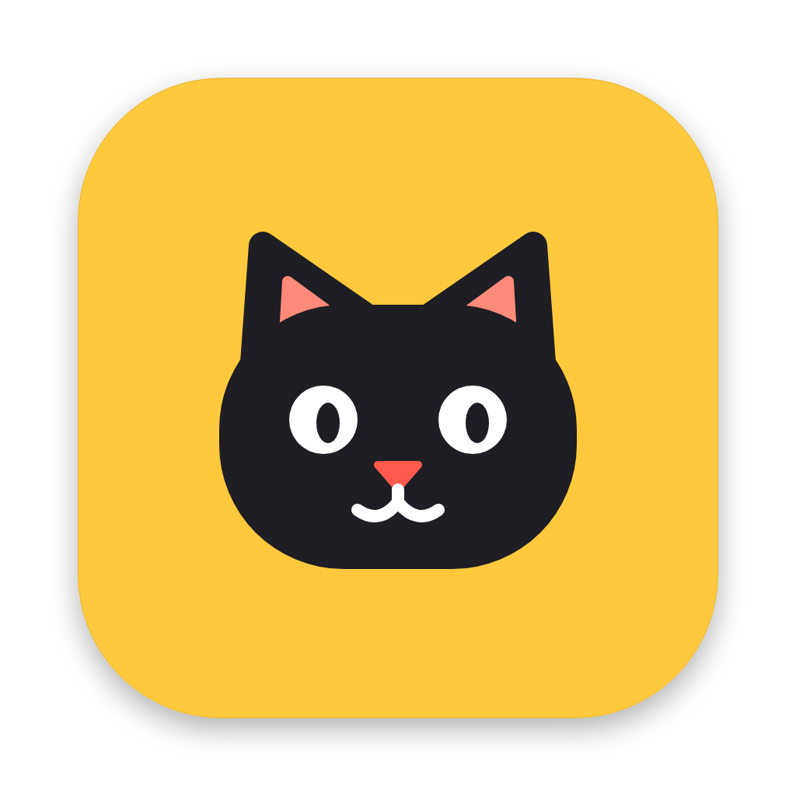
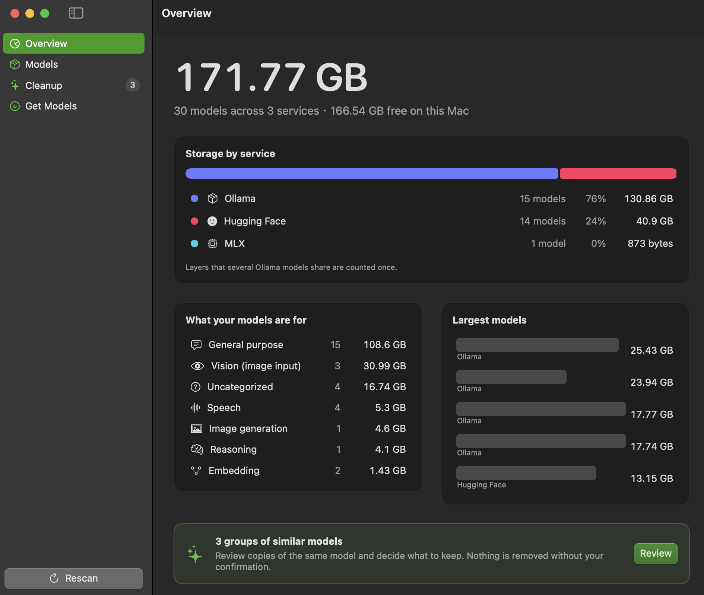

<p align="center">
  
</p>

<h1 align="center">Pantry</h1>

**See, fetch and clear out the local AI models on your Mac.**

Ollama, llama.cpp, MLX and Hugging Face each keep models in a different folder. Pantry reads
all of them, shows what you have and what it costs, helps you download more, finds copies you
don't need, and removes things only when you say so.

> *Pantry* is a working title. See [docs/NAMING.md](docs/NAMING.md) for alternatives, and
> `scripts/rename-app.sh` to rename everything in one command.

Apple Silicon · macOS 14+ · SwiftUI · no dependencies · MIT

<p align="center">
  
</p>

<!-- More screenshots to add: Models, Cleanup, menu bar popover. -->

## Features

| | |
|---|---|
| **Overview** | Total storage, breakdown by service and by use, largest models, free disk space, and one callout when there is something to clean up. |
| **Models** | Every model in one sortable table: service, what it's used for (general, coding, reasoning, vision, image generation, embedding, speech, safety/policy judge, reranker), size, date. Search, filters, and an inspector showing exactly how much space a removal would free. |
| **Get Models** | Pull from **Ollama** (paste a name, an `ollama run …` command or a link), or search **Hugging Face / MLX / GGUF** and download a whole repo or a single quantization. Size and free space are checked first; progress is real bytes. |
| **Cleanup** | *Identical copies* (same bytes, found by content hash) and *same model, different builds* (for example `llama3.2:3b` in Ollama and a 4-bit MLX conversion). |
| **Menu bar** | An icon with the total size (or download %) beside it. The popover shows the breakdown by service, running downloads with cancel, and a cleanup hint, without opening the window. |
| **Removal** | Always confirmed, with exact items and bytes. Defaults to Move to Trash; permanent delete is a separate, second-confirmed button. Shared Ollama layers are kept while another model still uses them. |

"Used for" is a best guess from the name and metadata. You can correct any model from its
context menu and Pantry remembers.

## Install

Requires macOS 14+ and Xcode 15+ (or the Swift 5.9+ command line tools).

```bash
git clone <this repo> && cd Pantry
swift run Pantry                 # run from Terminal
swift test                       # run the unit tests
./scripts/build_dmg.sh           # test + release build + build/Pantry.dmg
```

`build_dmg.sh` stops and prints a summary if a test fails. Useful options:

```bash
./scripts/build_dmg.sh --skip-tests
./scripts/build_dmg.sh --sign "Developer ID Application: Name (TEAMID)" --notarize PROFILE
```

You can also `open Package.swift` and press Run in Xcode. The default build is ad-hoc signed,
which is fine on the Mac that built it. On another Mac, right-click the app and choose Open
once. Change `BUNDLE_ID` at the top of `scripts/build_dmg.sh` before distributing.

Pantry is not sandboxed (it has to read and delete in other tools' folders), so it can't go on
the Mac App Store. If macOS asks for access to a folder or external drive, allow it.

## Where it looks

| Service | Default folder | Override |
|---|---|---|
| Ollama | `~/.ollama/models` | `OLLAMA_MODELS` |
| Hugging Face | `~/.cache/huggingface/hub` | `HF_HUB_CACHE`, `HF_HOME`, `XDG_CACHE_HOME` |
| MLX | same Hugging Face cache (where `mlx-lm` downloads) | |
| llama.cpp | `~/Library/Caches/llama.cpp` | `LLAMA_CACHE` |
| Anything else | Settings → *Your own folders* (GGUF files, safetensors folders, another HF cache) | |

Apps launched from Finder don't inherit shell environment variables. If you set
`OLLAMA_MODELS` in `.zshrc`, add that folder under Settings instead.

Gated Hugging Face models: run `hf auth login` once. Pantry reads the token the CLI saves and
never stores it.

## Privacy

No account, no telemetry, no analytics. The only network calls are the ones you ask for:
Ollama on `localhost`, and `huggingface.co` for search and downloads.

## What's new

Version 0.1.0, the first release:

* Scans Ollama, Hugging Face, MLX, llama.cpp and your own folders into one library.
* Dashboard with storage by service and by use; shared layers counted once.
* Duplicate and lookalike detection, with guarded, confirmed removal.
* Downloads for Ollama and Hugging Face / MLX / GGUF.
* Menu bar item with a glanceable popover; the app keeps running when the window is closed.
* One-command build, test and DMG script.

Full details in [CHANGELOG.md](CHANGELOG.md).

## Project layout

```
Pantry/
├─ Package.swift
├─ Sources/
│  ├─ PantryCore/        all logic, no UI imports, unit tested
│  │  ├─ Models/         ModelEntry, ModelService, ModelCategory
│  │  ├─ Naming/         name parser, classifier
│  │  ├─ Scanning/       Ollama, Hugging Face cache and loose-folder scanners
│  │  ├─ Analysis/       storage summary, hashing, duplicates, menu bar title
│  │  ├─ Removal/        planner and guarded executor
│  │  ├─ Downloads/      Ollama pull, Hugging Face client and cache writer
│  │  └─ Support/        path safety, sizing, disk space, formatting
│  └─ Pantry/            SwiftUI app: AppModel, Views/, MenuBar/, Support/
├─ Tests/PantryCoreTests/
├─ docs/                 ARCHITECTURE, UX-REVIEW, NAMING
├─ scripts/              build_dmg.sh, build-app.sh, rename-app.sh, syntax-check.py
└─ .github/workflows/    CI: build and test on macOS, syntax check on Linux
```

## Tests

`swift test` runs 90 unit tests against real files built in temporary folders: Ollama manifests
and blobs, Hugging Face caches with real symlinks, sharded GGUFs, llama.cpp sidecars. They cover
scanners, name parsing and classification, shared-storage accounting, duplicate detection,
removal planning and its safety rules (outside-folder, symlink escape, all-or-nothing refusal),
download parsing and cache layout, and the menu bar title.

The SwiftUI layer is thin and not unit tested, and downloads are tested through their parsing
and file layout rather than against live servers. See [docs/UX-REVIEW.md](docs/UX-REVIEW.md)
for how the interface was reviewed and what still needs real users.

## Known limitations

* Duplicate detection hashes files that share an exact size; a very large duplicate takes a
  while (it runs in the background).
* "Similar model" matching is name based and conservative: an unknown parameter size is never
  guessed, so some real matches are missed rather than wrongly merged.
* An interrupted Hugging Face download restarts the current *file* from zero (finished files are kept).
* Only `models--*` entries of the Hugging Face cache are listed.
* The Ollama suggestions in *Get Models* are hard-coded and may drift from the library.
* LM Studio, Jan, GPT4All and similar aren't built in; add their folder as a custom folder, or
  see "Extending" in [docs/ARCHITECTURE.md](docs/ARCHITECTURE.md).

## Docs

* [Architecture](docs/ARCHITECTURE.md): data flow, where each service stores models, and why the
  removal and duplicate logic works the way it does.
* [UX review](docs/UX-REVIEW.md): the ten Laws of UX applied screen by screen.
* [Naming](docs/NAMING.md): name options and how to rename.
* [Changelog](CHANGELOG.md)

## License

MIT. See [LICENSE](LICENSE).

## Credits

Menu bar glyph: "cat" from [Griddy Icons](https://github.com/griddy-icons/griddy-icons) by Zuzana Benova (MIT); see `resources/MenuBarGlyph-LICENSE.txt`.
